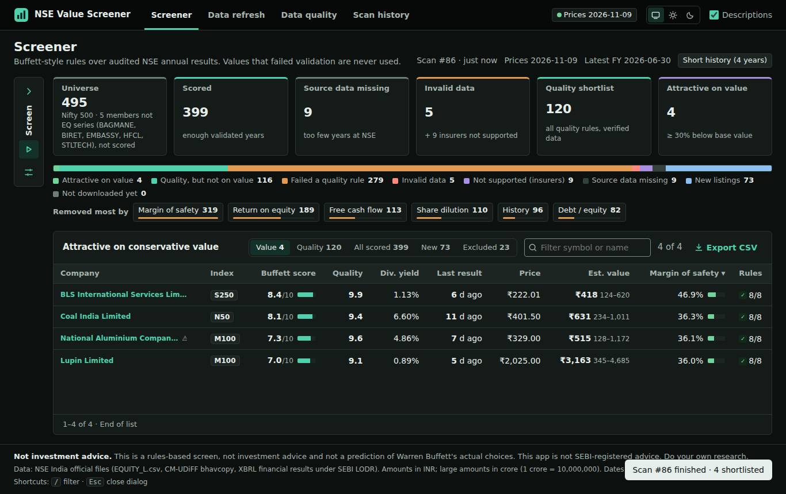
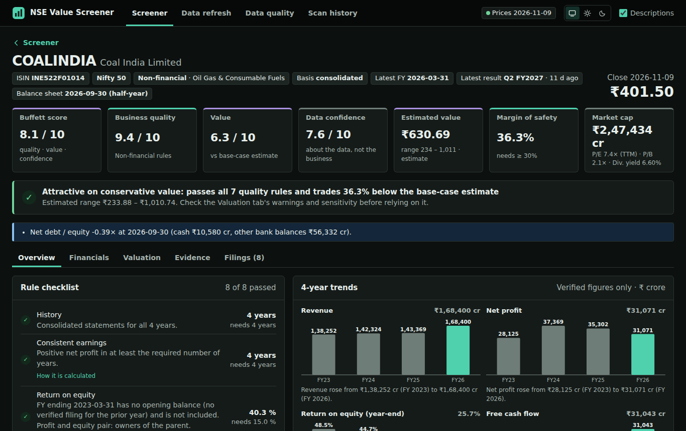

# Value Like Buffett – NSE Stock Screener

**Screen India's Nifty 500 the way a long-term value investor would — using only official NSE data.**

Value Like Buffett is a local web app that checks every Nifty 500 company against documented Buffett-style principles
(durable profitability, high return on equity, low debt, real free cash flow, no shareholder dilution), estimates what
each business is worth, and shortlists the companies trading at a real margin of safety. Every number links back to the
official NSE filing it came from.

> **Not investment advice.** Value Like Buffett is a rules-based screen. It is not a prediction of what Warren Buffett
> would actually buy, and it is not SEBI-registered advice. Do your own research.



## Features

### Screening
- **Nifty 500 universe** (Nifty 100 + Midcap 150 + Smallcap 250), with Nifty 50 / 100 / 200 / all-NSE selectable.
  New listings are shown separately until they have enough annual results.
- **Buffett-style quality rules:** consistent profits, average ROE, debt / equity, margin stability, positive free cash
  flow, share dilution, book-value growth — with separate rules for banks, NBFCs and insurers.
- **Explains every exclusion:** a funnel shows how many companies each rule removed, and every company has a
  pass/fail checklist with the exact figure behind each rule.
- **Editable thresholds and presets**, including a *Classic Buffett* preset (10 years, ROE ≥ 15%, D/E ≤ 0.5,
  margin of safety ≥ 30%).

### Valuation


- **Bear / base / bull owner-earnings DCF** for every non-financial company, shown as a value *range*, never a single
  "target price".
- **Margin of safety** against today's NSE closing price.
- **Separate 0–10 scores** for business quality, valuation and data confidence, plus an overall **Buffett score** that
  abstains rather than guess when an input is missing.
- Trailing-twelve-month P/E and EPS, latest balance-sheet debt, dividend yield from NSE corporate actions.
- International accounting adjustments: continuing operations (IFRS 5), underlying profit without exceptional items,
  lease-adjusted free cash flow (IFRS 16), owners vs non-controlling interests (IFRS 10).

### Data you can trust (and check)
- **Official sources only:** NSE equity list, NSE index files, NSE CM-UDiFF bhavcopy (prices) and the XBRL annual
  results companies file with NSE under SEBI LODR.
- **Provenance on every figure** and a quality verdict (verified / conflicting / unsupported / missing). Unverified
  figures are never scored.
- **Validation:** assets = liabilities + equity, unit and scale checks (lakhs / crores), share-count and
  split/bonus checks, period-to-period contradictions.
- **Reconciliation:** stored figures are re-extracted by an independent parser; mismatches are quarantined.
- **Data quality page** listing every failed, missing or contradictory filing.

### Built for daily use
- Polite, resumable refresh: paced requests, back-off on blocks, checkpoints, estimated time left.
- Scan history, CSV export, keyboard shortcuts, light and dark themes, WCAG 2.2 AA accessibility.
- Runs entirely on your own computer; no account, no credentials, no third-party runtime dependencies.

## Download
Free and open source (MIT). Download `nse-value-screener-2.2.2.zip` from
[Releases](https://github.com/buildsbeyondai-code/buffett-lens-ai/releases/latest), then:

```bash
unzip nse-value-screener-2.2.2.zip && cd nse-value-screener
python3 -m app init && python3 -m app serve --port 5071   # http://127.0.0.1:5071/
```

Requires Python 3.11+ (standard library only). Your AI agent can also install it with the Agensi skill
"Buffett-Style NSE Stock Screener With DCF Value Ranges". Questions: **buildsbeyondai@gmail.com**.

Engineering: Python standard library only, about 290 automated tests (unit, property-based, browser end-to-end with
accessibility checks), CI on Python 3.11–3.14.

---
© 2026 Jude Finney. All rights reserved. NIFTY is a registered trademark of NSE Indices Limited; this project is not
affiliated with or endorsed by NSE.
